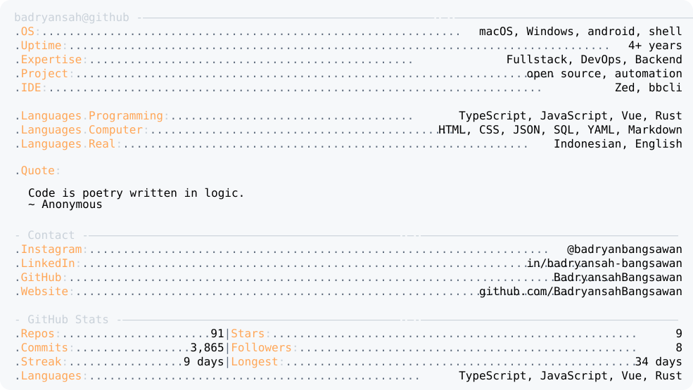

<a href="https://github.com/BadryansahBangsawan/badryansahbangsawan">
  <picture>
    <source media="(prefers-color-scheme: dark)" srcset="https://raw.githubusercontent.com/BadryansahBangsawan/badryansahbangsawan/main/assets/dark_mode.svg?v=ac10e96a2295">
    
  </picture>
</a>
